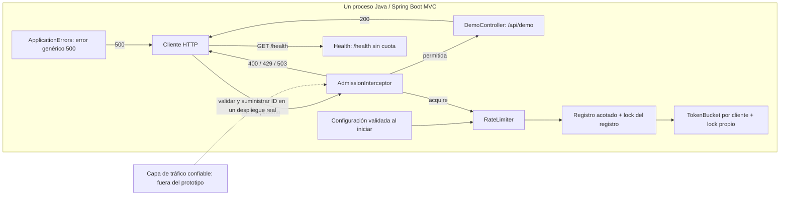
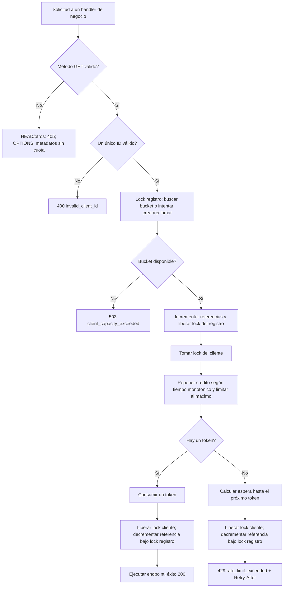
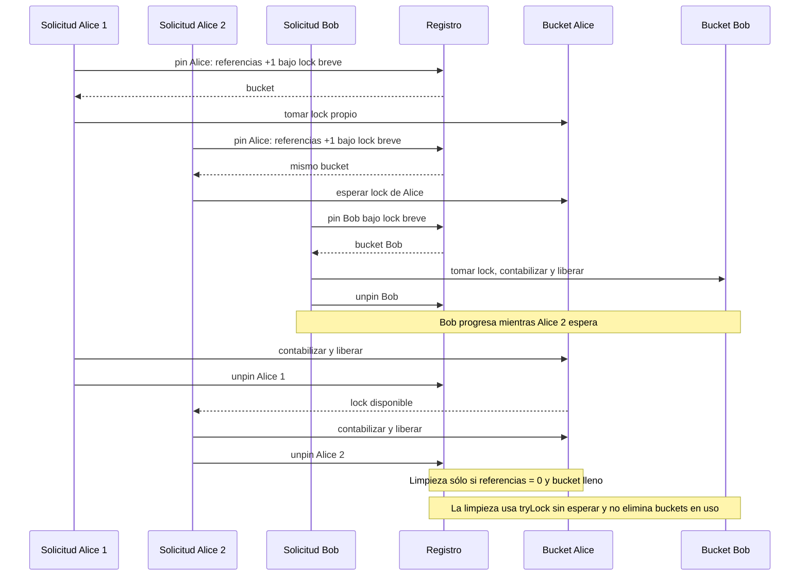

# IOL system design challenge

A single-process Java 21 token bucket rate limiter embedded in a Spring Boot MVC
demo API. It includes per-client locking, validated client-ID headers, a bounded
in-memory registry, Docker packaging, and line/branch coverage reporting.

Java tests, Docker image/runtime checks, and Python scenarios pass. See the
[project README](rate-limiter/README.md) for commands and the
[verification record](rate-limiter/docs/technical/VERIFICATION.md) for evidence.

Public repository: [AriSchermuk/Challenge-IOL](https://github.com/AriSchermuk/Challenge-IOL).
Multiple-instance support, configurable algorithms, and client/endpoint-specific
policies are future extensions. CI, metrics, and a coverage threshold are not included.

## Run the demonstration

The Python script is the brief end-to-end demonstration: it creates isolated Docker
containers, prints expected/actual results, and produces HTML/JSON reports.

```sh
python3 rate-limiter/scripts/probar_api.py
```

Requires Python 3.9+ and a running Docker engine. If the image is absent, it is built
automatically. See [run instructions](rate-limiter/README.md) for Java/Docker commands,
configuration, report locations, and limitations. Latest execution: 26/26 scenarios
passed; the Java suite has 17 passing tests. See the [verification evidence](rate-limiter/docs/technical/VERIFICATION.md).

## Diagramas

These diagrams describe the current single-process implementation. A trusted traffic
layer is a deployment prerequisite for verified identities, not a component implemented
by this demo. The real application accepts syntactically valid client IDs.

### Arquitectura



The adapter calls `RateLimiter.acquire`. Core classes depend on Java only, not
Spring or HTTP.

### Flujo de admisión



Health and unknown routes do not enter this business flow. Locks and references are
released with `finally`, including on unexpected failures; application errors map
to a generic 500. Admission remains charged if the endpoint subsequently fails.

### Concurrencia y ciclo de vida



No request holds a bucket lock while acquiring the registry lock. Registry lookups
still coordinate briefly, and reclamation can scan O(N) entries. Details and proof
obligations are in [DESIGN.md](rate-limiter/DESIGN.md).

## Documentation

Review in this order:

1. [Business requirements](rate-limiter/docs/business/REQUIREMENTS.md): purpose, scope, and expected outcomes.
2. [Usage options](rate-limiter/docs/business/USAGE-OPTIONS.md): how the three integration options work and what they mean for the project.
3. [Decisions](rate-limiter/docs/technical/DECISIONS.md): technical choices, alternatives, and tradeoffs.
4. [Technical specification](rate-limiter/docs/technical/SPEC.md): precise behavior and acceptance criteria.
5. [Implementation plan](rate-limiter/docs/delivery/PLAN.md): delivery steps and verification.

See the [documentation guide](rate-limiter/docs/README.md) for document responsibilities
and the process for keeping requirements, implementation, and tests aligned.

## Challenge context

This project implements the rate limiter problem from Alex Xu's *System Design
Interview*, Volume 1. The challenge calls for working, tested code and a
`DESIGN.md` describing architectural choices, tradeoffs, and AI use.

[DESIGN.md](rate-limiter/DESIGN.md) describes the implementation and includes the
AI-use disclosure. Technical requirements and verification evidence are linked above.
