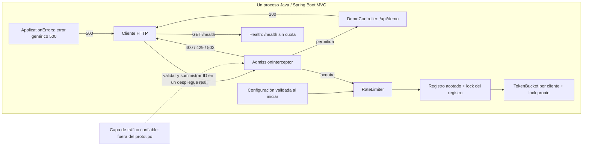
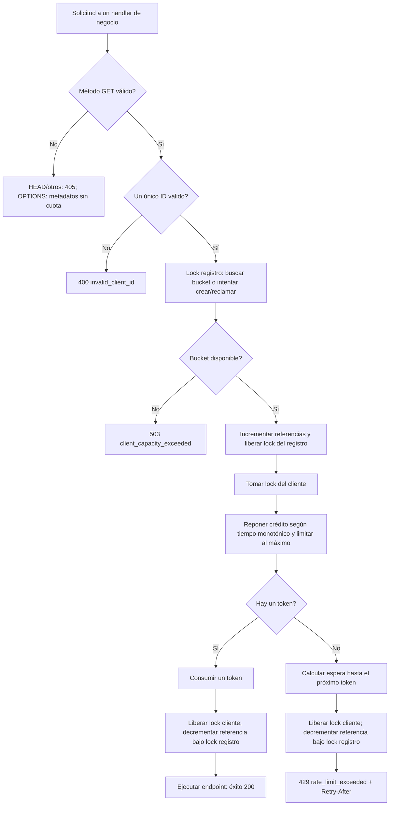
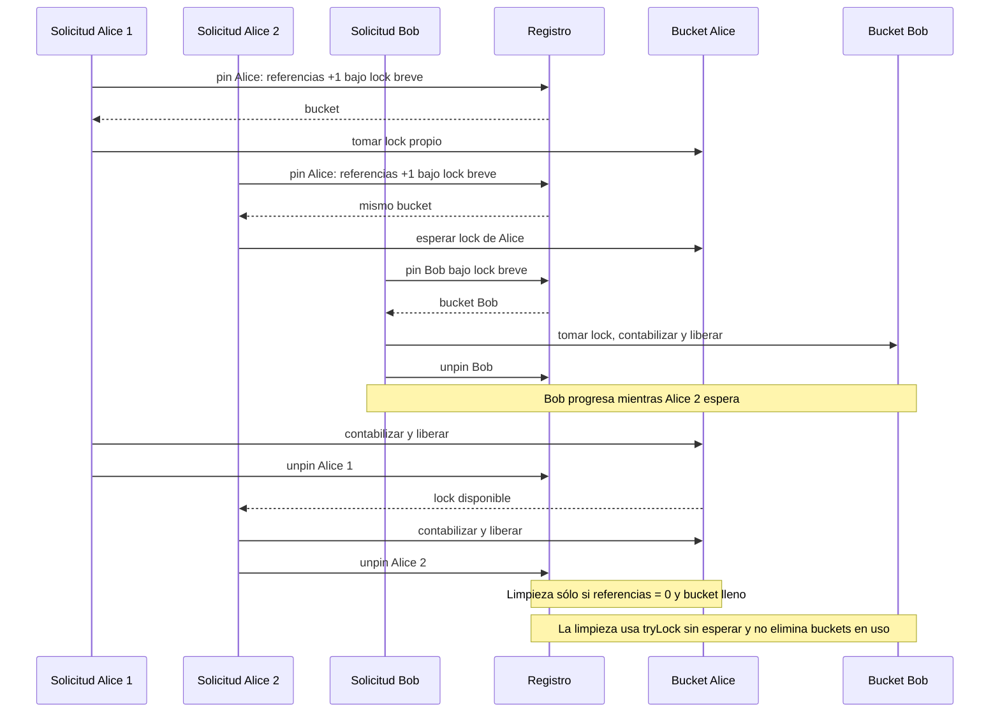

# IOL system design challenge

Status: approved implementation, Java tests, coverage, Docker image build, and
container runtime verification complete. Local Docker engine is installed and running. See the
[project README](rate-limiter/README.md) and [verification record](rate-limiter/docs/technical/VERIFICATION.md).

The project is a single-process Java 21 token bucket rate limiter embedded in a
Spring Boot MVC demo API. All individual scope and technical choices are approved;
the consolidated specification was approved before implementation.

JUnit, Maven Wrapper, per-client locking, validated client-ID headers, a shared
startup-configured policy, a hard client limit, logging, Docker, and line/branch
coverage reporting are included. Exact delegated tool selections and their sources
are recorded in SPEC.md. Metrics, CI, and a coverage threshold remain deferred. Public repository: [AriSchermuk/Challenge-IOL](https://github.com/AriSchermuk/Challenge-IOL). Multiple-instance support, configurable algorithms, and alternate
client/endpoint policies are documented future directions.

## Run the demonstration

The Python script is the brief end-to-end demonstration: it creates isolated Docker
containers, prints expected/actual results, and produces HTML/JSON reports.

```sh
python3 rate-limiter/scripts/probar_api.py
```

Requires Python 3.9+ and a running Docker engine. If the image is absent, it is built
automatically. See [run instructions](rate-limiter/README.md) for Java/Docker commands,
configuration, report locations, and limitations. Latest execution: 26/26 scenarios
passed; the Java suite has 17 passing tests. See the [verification evidence](rate-limiter/docs/technical/VERIFICATION.md).

## Diagramas

These diagrams describe the current single-process implementation. A trusted traffic
layer is a deployment prerequisite for verified identities, not a component implemented
by this demo. The real application accepts syntactically valid client IDs.

### Arquitectura



The adapter calls `RateLimiter.acquire`. Core classes depend on Java only, not
Spring or HTTP.

### Flujo de admisión



Health and unknown routes do not enter this business flow. Locks and references are
released with `finally`, including on unexpected failures; application errors map
to a generic 500. Admission remains charged if the endpoint subsequently fails.

### Concurrencia y ciclo de vida



No request holds a bucket lock while acquiring the registry lock. Registry lookups
still coordinate briefly, and reclamation can scan O(N) entries. Details and proof
obligations are in [DESIGN.md](rate-limiter/DESIGN.md).

## Documentation

Review in this order:

1. [Business requirements](rate-limiter/docs/business/REQUIREMENTS.md): purpose, scope, and expected outcomes.
2. [Usage options](rate-limiter/docs/business/USAGE-OPTIONS.md): how the three integration options work and what they mean for the project.
3. [Decisions](rate-limiter/docs/technical/DECISIONS.md): choices, recommendations, and approval status.
4. [Technical specification](rate-limiter/docs/technical/SPEC.md): precise behavior and acceptance criteria.
5. [Implementation plan](rate-limiter/docs/delivery/PLAN.md): delivery steps and verification.

See the [documentation guide](rate-limiter/docs/README.md) for document ownership
and the process for keeping requirements, implementation, and tests aligned.

The documents record approved individual decisions and their consolidated design.
Work continues through the approved plan without routine approval pauses. If a
decision changes, update affected documents before changing behavior.

## Collaboration agreement

- The owner makes meaningful decisions and reviews understanding and submission readiness.
- The assistant implements, recommends alternatives, documents, tests, and follows
  the challenge rules.
- Ask at meaningful deviations/crossroads. Phase milestones are progress records,
  not automatic approval stops when work follows the approved plan.
- Explain options, consequences, and a recommendation before asking for a decision.
- Approval of a phase does not imply approval of an unreviewed change in scope.
- Do not begin implementation until the complete specification is approved.

## Challenge requirements

Source: the interview challenge brief supplied by the owner (not redistributed here).

- Implement a working prototype of one problem from Alex Xu's Volume 1.
- Java is one of the permitted languages.
- The code must build and pass tests; core logic needs comprehensive tests.
- Handle errors correctly; use concurrency when needed; avoid overengineering.
- Create a new repository and a folder named for the problem.
- Include `DESIGN.md` in that folder, explaining architecture, tradeoffs, and AI use.
- Clearly comment any AI-generated code the owner does not understand. Keep such
  code to a minimum and review understanding before submission.
- Logging, metrics, deployment ease, and defensive design are desirable extras.
- Submit the repository link. Publication/submission is a separate owner decision.

The project is published at [AriSchermuk/Challenge-IOL](https://github.com/AriSchermuk/Challenge-IOL);
local `main` tracks `origin/main`.
[DESIGN.md](rate-limiter/DESIGN.md) describes the implemented architecture, tradeoffs,
and AI usage. The owner understanding review is in progress.
